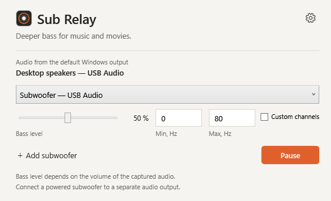

# Sub Relay

**Add a powered subwoofer to your Windows audio setup.**

Sub Relay sends low frequencies from your default Windows audio output to a separate output connected to a powered subwoofer. Keep listening through your usual speakers and add bass to music, films and everyday audio from one small window.

[Download for Windows](https://github.com/Lord-of-the-Bots/SubRelay/releases/latest)



## Get started

1. Install **SubRelay-Setup-1.0.0.exe** from the [release](https://github.com/Lord-of-the-Bots/SubRelay/releases/tag/v1.0.0). Windows 10/11 x64; no administrator rights or separate .NET installation needed.
2. Keep your main speakers selected as the default Windows output. Connect your powered subwoofer's line input to a **different audio output**, such as a spare USB sound card.
3. Select the subwoofer output in Sub Relay. Start with a low volume on the subwoofer amplifier, then adjust **Bass level** and the frequency limits.

The default upper limit is **80 Hz**. The lower limit is **0 Hz**, which leaves the low cut disabled. Bass level starts at **50%**. Adjust these settings to your speakers, subwoofer and room; they are starting values, not automatic calibration.

For a portable copy, extract **SubRelay-Portable-1.0.0-win-x64.zip** to a permanent writable folder and run **SubRelay.exe**. Keep the included dependency notices and licenses. Settings are stored in `Data` beside the executable.

## Controls

- **Bass level:** independent output level for each sound card.
- **Frequency limits:** 0–200 Hz; the lower value must be below the upper value. Invalid entries are not applied.
- **Custom channels → Open mapper:** select individual channels on a sound card and set a frequency range for each. Unchecked channels receive no audio from Sub Relay. Without custom mapping, bass is sent to all channels on the selected output.
- **Add subwoofer:** add another sound card with its own settings. Select **Not selected** to remove a row; the last row stays available.
- **Pause / Resume:** stop or resume all Sub Relay outputs. Your main speakers keep playing.
- **Settings:** change startup with Windows, closing to the tray, or the interface language. Startup and closing to the tray are enabled by default.

Audio devices refresh automatically, and capture follows changes to the default Windows output. Selecting that same output as a subwoofer destination disables the route to prevent feedback. Hover over the warning icon for details.

The interface supports English, Russian, Brazilian Portuguese and Spanish, with the Windows display language selected initially.

## Before connecting

Sub Relay needs a powered subwoofer with a suitable audio input, or a passive subwoofer with an appropriate external amplifier. It does not power a speaker or add physical outputs to a sound card.

**Use a separate Windows playback device for the subwoofer.** A different jack or channel on the same default playback device is not sufficient. Custom channel mapping chooses channels on the destination device; it does not split the default device into separate outputs.

Bass level follows the audio available to loopback capture. Adjust the volume in your player first, then the level in Sub Relay. The main Windows device volume slider may not change the captured level. Muting the main speakers is therefore not a reliable way to mute the subwoofer: use **Pause**.

The main speakers receive their original signal. Sub Relay does not high-pass them, perform room correction, or automatically align timing with the subwoofer. Capture, playback buffers and device processing introduce delay; how well the bass blends with your speakers depends on the setup. This is especially relevant when combining outputs with different latency. An existing subwoofer low-pass filter also affects the final response.

Sub Relay filters the captured mix into mono bass; it is not a Dolby/DTS decoder or a dedicated LFE extractor. Audio that bypasses Windows shared playback, or protected content that blocks loopback capture, may not be available.

## Build

Requires Windows and the .NET 10 SDK:

```powershell
.\SubRelay\build.ps1
```

This creates the self-contained executable and dependency notices in `output/SubRelay`.

To build an installer, install Inno Setup and run:

```powershell
.\SubRelay\build-installer.ps1 -CompilerPath "C:\Path\To\Inno Setup 6\ISCC.exe"
```

Audio uses NAudio 2.2.1 and WASAPI loopback. Dependency notices are in [THIRD-PARTY-NOTICES.txt](SubRelay/THIRD-PARTY-NOTICES.txt) and [Licenses](SubRelay/Licenses).

## Feedback

[Open an issue](https://github.com/Lord-of-the-Bots/SubRelay/issues) with your Windows version, main audio output, subwoofer output and a short description of the problem. A screenshot of the settings or error helps.

## Support development

If Sub Relay is useful in your setup, you can support its development:

BTC (Bitcoin):
1NbtPNkofnKZRjLpULRjhKuAtbh12DovC9

USDT, TRX (TRC20):
TUgM6hPokF1vPUW8CRp77CgvF3YroabwFP

TON:
UQBLdOWJeVeVg4b0-HkQGNVV8HG6-xWS7moZOUfNBz2-Jf3u

ETH (ERC20):
0x14bba7b8b76ea4743a202bdee2144e4d558ddf93

LTC (Litecoin):
LRRS5YBeqfkYpw2jC2bDAWgpcgm7Wpu6pM
